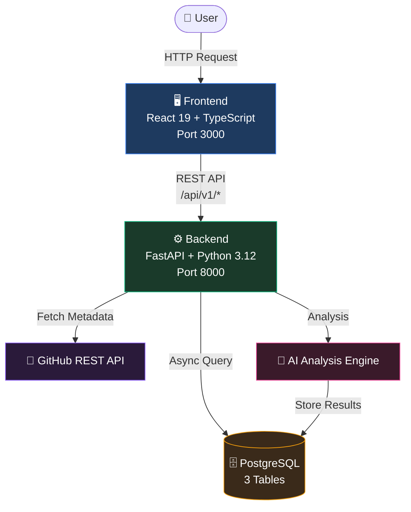

<p align="center">
  
  
  
  
  
  
  
  
</p>

<h1 align="center">RepoInsight AI</h1>

<p align="center">
  <strong>AI-Powered GitHub Repository Analysis Platform</strong><br>
  <em>Menganalisis, memantau, dan memahami repository GitHub Anda secara otomatis dengan kekuatan kecerdasan buatan.</em>
</p>

<p align="center">
  <a href="#-fitur">Fitur</a> •
  <a href="#-tech-stack">Tech Stack</a> •
  <a href="#-arsitektur">Arsitektur</a> •
  <a href="#-getting-started">Getting Started</a> •
  <a href="#-api-documentation">API Docs</a> •
  <a href="#-testing">Testing</a> •
  <a href="#-license">License</a>
</p>

---

## ✨ Fitur

- **Repository Management** — Daftarkan, pantau, dan kelola GitHub repository dalam satu platform terpadu
- **AI Analysis Engine** — Jalankan analisis mendalam terhadap kode, struktur, dan kualitas repository menggunakan mesin AI
- **Dashboard Statistik** — Visualisasikan data repository, analisis, dan metrik penting dalam satu tampilan komprehensif
- **Perbandingan Analisis** — Bandingkan hasil analisis antar versi repository untuk melacak perubahan dan kemajuan
- **JWT Authentication** — Sistem autentikasi yang aman menggunakan JSON Web Token dengan bcrypt hashing
- **Dark-Tech UI** — Antarmuka modern dengan tema dark-tech, aksen electric blue (#3B82F6), dan efek glassmorphism
- **GitHub Integration** — Integrasi langsung dengan GitHub REST API untuk pengambilan metadata repository secara otomatis
- **RESTful API** — Backend API terstruktur dengan prefix `/api/v1/` dan dokumentasi interaktif via Swagger & ReDoc
- **Async Architecture** — Arsitektur asinkronis dengan SQLAlchemy Async dan FastAPI untuk performa tinggi
- **Database Migrations** — Manajemen skema database yang terstruktur menggunakan Alembic

---

## 🛠 Tech Stack

### Backend

| Komponen | Teknologi |
|----------|-----------|
| Framework | FastAPI |
| Bahasa | Python 3.12 |
| ORM | SQLAlchemy (Async) |
| Migrations | Alembic |
| Validasi | Pydantic v2 |
| Autentikasi | python-jose + bcrypt |
| Testing | pytest + pytest-asyncio |
| HTTP Client | httpx (GitHub API) |

### Frontend

| Komponen | Teknologi |
|----------|-----------|
| Framework | React 19 |
| Bahasa | TypeScript 6 |
| Bundler | Vite 8 |
| Routing | React Router 7 |
| Styling | CSS Modules |
| HTTP Client | Native Fetch API |

### Database

| Komponen | Teknologi |
|----------|-----------|
| Database | PostgreSQL |
| Driver | asyncpg |
| Tables | users, repositories, analyses |

### Authentication

| Komponen | Teknologi |
|----------|-----------|
| Token | JWT Bearer Tokens |
| Hashing | bcrypt |
| Library | python-jose |
| Penyimpanan | localStorage (frontend) |
| Default Expiry | 1440 menit (24 jam) |

---

## 🏗 Arsitektur



**Alur Kerja:**
1. Pengguna mengakses aplikasi melalui frontend React
2. Frontend mengirim request ke backend FastAPI via REST API (`/api/v1/*`)
3. Backend memproses request dan berinteraksi dengan PostgreSQL untuk data persistence
4. Untuk metadata repository, backend mengambil data dari GitHub REST API
5. Hasil analisis disimpan ke database dan dikembalikan ke frontend

---

## 📁 Folder Structure

```
repoinsight-ai/
├── backend/
│   ├── app/
│   │   ├── api/v1/          # Route handlers (auth, repos, analyses, health, dashboard)
│   │   ├── core/            # Konfigurasi, security, database connection, middleware
│   │   ├── db/              # SQLAlchemy models (users, repositories, analyses)
│   │   ├── integrations/    # GitHub API client
│   │   ├── repositories/    # Data access layer (repository pattern)
│   │   ├── schemas/         # Pydantic models (request/response schemas)
│   │   ├── services/        # Business logic layer
│   │   ├── tests/           # pytest test suite (212 tests)
│   │   └── main.py          # FastAPI application entry point
│   ├── alembic/             # Database migration scripts
│   └── requirements.txt     # Python dependencies
├── frontend/
│   ├── src/
│   │   ├── api/             # API client (fetch wrapper)
│   │   ├── components/      # Reusable UI components
│   │   ├── context/         # React context providers (auth, theme)
│   │   ├── pages/           # Halaman-halaman aplikasi
│   │   ├── types/           # TypeScript type definitions
│   │   └── utils/           # Utility functions
│   └── package.json         # Node.js dependencies
├── docs/                    # Dokumentasi proyek
└── README.md                # File ini
```

---

## 🚀 Getting Started

### Prerequisites

- **Python 3.12+** dan **pip**
- **Node.js 18+** dan **npm**
- **PostgreSQL** (running di localhost:5432)

### Langkah 1 — Clone Repository

```bash
git clone https://github.com/your-username/repoinsight-ai.git
cd repoinsight-ai
```

### Langkah 2 — Setup Backend

```bash
cd backend

# Buat virtual environment
python -m venv venv

# Aktifkan virtual environment
# Windows:
venv\Scripts\activate
# macOS/Linux:
source venv/bin/activate

# Install dependencies
pip install -r requirements.txt
```

### Langkah 3 — Konfigurasi Environment Variables

```bash
# Salin file .env.example ke .env
cp .env.example .env

# Edit .env sesuai konfigurasi lokal Anda
# Pastikan REPOINSIGHT_DATABASE_URL sudah benar
```

### Langkah 4 — Jalankan Database Migrations

```bash
# Jalankan migrasi Alembic
alembic upgrade head
```

### Langkah 5 — Jalankan Backend

```bash
# Jalankan server FastAPI
uvicorn app.main:app --reload --host 0.0.0.0 --port 8000
```

Backend tersedia di `http://localhost:8000`

### Langkah 6 — Setup Frontend

```bash
cd ../frontend

# Install dependencies
npm install

# Jalankan development server
npm run dev
```

Frontend tersedia di `http://localhost:3000`

---

## 🔧 Environment Variables

Backend dikonfigurasi menggunakan variabel lingkungan dengan prefix `REPOINSIGHT_`.

| Variable | Tipe | Default | Deskripsi |
|----------|------|---------|-----------|
| `REPOINSIGHT_APP_NAME` | `string` | `RepoInsight AI API` | Nama aplikasi |
| `REPOINSIGHT_ENVIRONMENT` | `string` | `development` | Environment mode (development/production) |
| `REPOINSIGHT_DEBUG` | `boolean` | `false` | Mode debug |
| `REPOINSIGHT_DATABASE_URL` | `string` | — | PostgreSQL connection URL (asyncpg) |
| `REPOINSIGHT_DATABASE_ECHO` | `boolean` | `false` | Tampilkan SQL query di console |
| `REPOINSIGHT_JWT_SECRET_KEY` | `string` | — | Secret key untuk JWT signing |
| `REPOINSIGHT_JWT_ALGORITHM` | `string` | `HS256` | Algoritma JWT |
| `REPOINSIGHT_ACCESS_TOKEN_EXPIRE_MINUTES` | `integer` | `1440` | Masa berlaku token (menit) |
| `REPOINSIGHT_GITHUB_API_URL` | `string` | `https://api.github.com` | GitHub API base URL *(opsional)* |
| `REPOINSIGHT_GITHUB_TOKEN` | `string` | — | GitHub personal access token *(opsional)* |
| `REPOINSIGHT_GITHUB_TIMEOUT` | `integer` | `30` | Timeout GitHub API request dalam detik *(opsional)* |

---

## 📖 API Documentation

Setelah menjalankan backend, dokumentasi API tersedia secara interaktif:

| Endpoint | Deskripsi |
|----------|-----------|
| [Swagger UI](http://localhost:8000/docs) | Interaktif API explorer — test endpoint langsung dari browser |
| [ReDoc](http://localhost:8000/redoc) | Dokumentasi API yang rapi dan terstruktur |

### API Endpoints

| Method | Endpoint | Deskripsi |
|--------|----------|-----------|
| `POST` | `/api/v1/auth/register` | Registrasi pengguna baru |
| `POST` | `/api/v1/auth/login` | Login dan dapatkan JWT token |
| `GET` | `/api/v1/auth/me` | Dapatkan data pengguna saat ini |
| `GET` | `/api/v1/health/live` | Health check (liveness) |
| `GET` | `/api/v1/health/ready` | Health check (readiness) |
| `GET` | `/api/v1/health/db` | Health check database |
| `GET` | `/api/v1/repositories` | Daftar semua repository |
| `GET` | `/api/v1/repositories/{id}` | Detail repository |
| `POST` | `/api/v1/repositories` | Tambah repository baru |
| `POST` | `/api/v1/repositories/{id}/scan` | Scan repository |
| `POST` | `/api/v1/repositories/{id}/analyze` | Jalankan analisis AI |
| `GET` | `/api/v1/repositories/{id}/analyses` | Daftar analisis repository |
| `GET` | `/api/v1/analyses/{id}` | Detail hasil analisis |
| `GET` | `/api/v1/analyses/{id}/compare/{prev_id}` | Bandingkan dua analisis |
| `GET` | `/api/v1/dashboard/stats` | Statistik dashboard |

---

## 🧪 Testing

### Backend (pytest)

```bash
cd backend

# Jalankan seluruh test suite
pytest

# Jalankan dengan verbose output
pytest -v

# Jalankan dengan coverage
pytest --cov=app --cov-report=html
```

Total: **212 test cases**

### Frontend (Vitest)

```bash
cd frontend

# Jalankan test suite
npm run test

# Jalankan dengan watch mode
npm run test -- --watch
```

Total: **12 test cases**

---

## 📐 Project Structure

### Architectural Decisions

- **Repository Pattern** — Pemisahan antara data access layer (`repositories/`) dan business logic (`services/`) untuk maintainability yang lebih baik
- **Schema Validation** — Menggunakan Pydantic v2 untuk validasi request/response di seluruh API endpoint
- **Async-First** — Seluruh database operations menggunakan SQLAlchemy Async untuk performa concurrent handling
- **Modular Frontend** — Komponen React diorganisir berdasarkan concern (pages, components, context, types, utils)
- **JWT Stateless Auth** — Autentikasi tanpa state server-side; token disimpan di localStorage frontend
- **CSS Modules** — Scoped styling tanpa style conflict, memanfaatkan native CSS tanpa framework tambahan
- **API Versioning** — Semua endpoint menggunakan prefix `/api/v1/` untuk kemudahan versioning di masa depan

### Design Philosophy

- **Dark-Tech Theme** — UI dengan latar gelap untuk mengurangi eye strain saat coding marathon
- **Electric Blue Accent (#3B82F6)** — Konsisten menggunakan biru elektrik sebagai primary color
- **Glassmorphism Navbar** — Efek transparan pada navbar untuk estetika modern
- **Minimal Dependencies** — Menggunakan native Fetch API alih-alih axios, mengurangi bundle size

---

## 🤝 Contributing

Kontribusi sangat diterima! Berikut langkah-langkahnya:

1. **Fork** repository ini
2. **Buat branch** baru untuk fitur Anda (`git checkout -b feature/nama-fitur`)
3. **Commit** perubahan Anda (`git commit -m 'Tambahkan nama-fitur'`)
4. **Push** ke branch (`git push origin feature/nama-fitur`)
5. **Buka Pull Request**

### Guidelines

- Ikuti code style yang sudah ada di proyek
- Pastikan semua test masih passing sebelum submit PR
- Tulis deskripsi yang jelas untuk setiap Pull Request
- Untuk perubahan besar, buka issue terlebih dahulu untuk diskusi

---

## 📄 License

```
MIT License

Copyright (c) 2026 RepoInsight AI

Permission is hereby granted, free of charge, to any person obtaining a copy
of this software and associated documentation files (the "Software"), to deal
in the Software without restriction, including without limitation the rights
to use, copy, modify, merge, publish, distribute, sublicense, and/or sell
copies of the Software, and to permit persons to whom the Software is
furnished to do so, subject to the following conditions:

The above copyright notice and this permission notice shall be included in all
copies or substantial portions of the Software.

THE SOFTWARE IS PROVIDED "AS IS", WITHOUT WARRANTY OF ANY KIND, EXPRESS OR
IMPLIED, INCLUDING BUT NOT LIMITED TO THE WARRANTIES OF MERCHANTABILITY,
FITNESS FOR A PARTICULAR PURPOSE AND NONINFRINGEMENT. IN NO EVENT SHALL THE
AUTHORS OR COPYRIGHT HOLDERS BE LIABLE FOR ANY CLAIM, DAMAGES OR OTHER
LIABILITY, WHETHER IN AN ACTION OF CONTRACT, TORT OR OTHERWISE, ARISING FROM,
OUT OF OR IN CONNECTION WITH THE SOFTWARE OR THE USE OR OTHER DEALINGS IN THE
SOFTWARE.
```

---

<p align="center">
  Dibuat dengan ❤️ oleh tim RepoInsight AI
</p>
