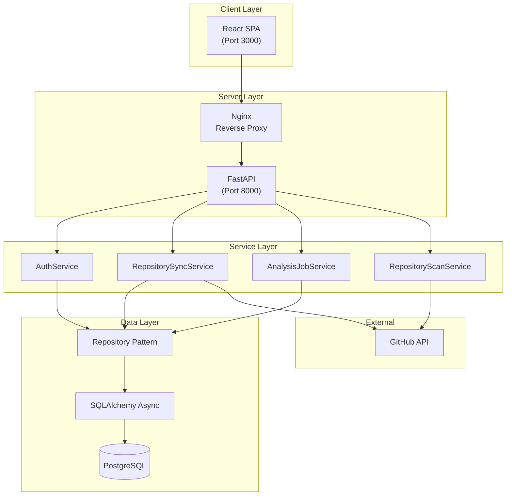
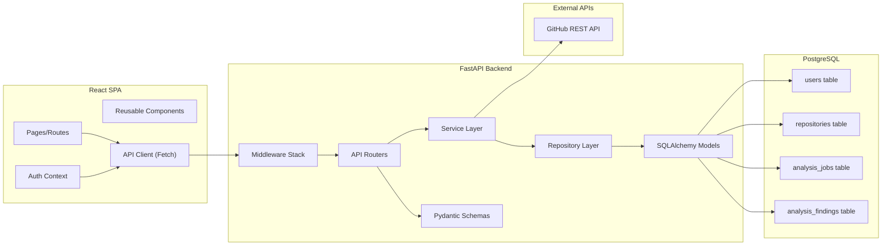
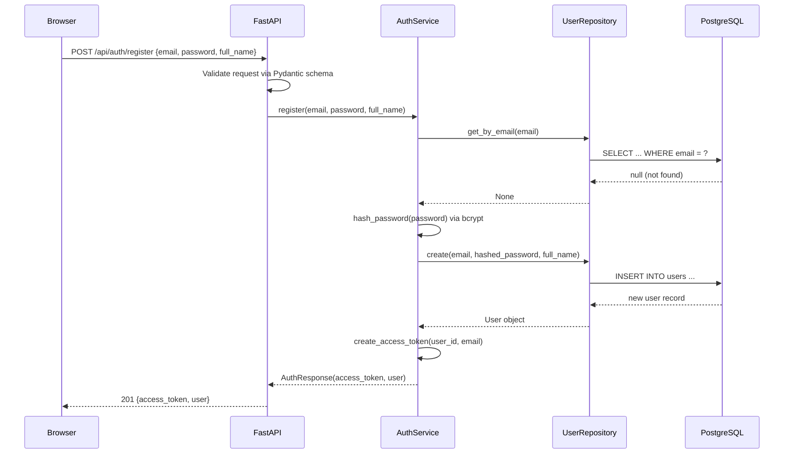
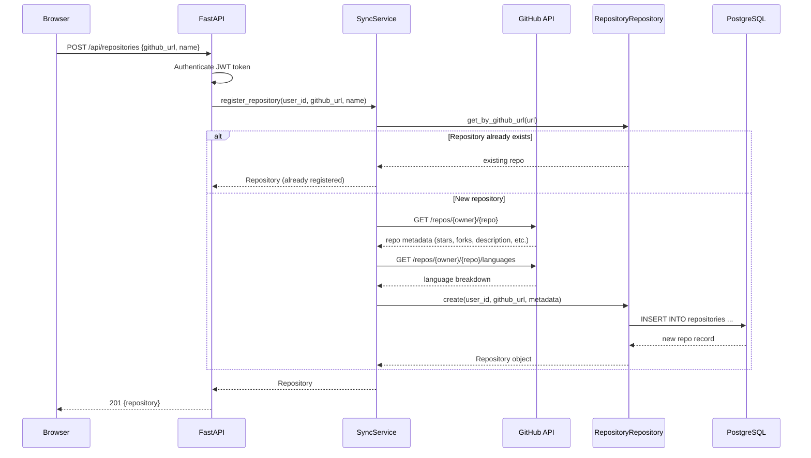
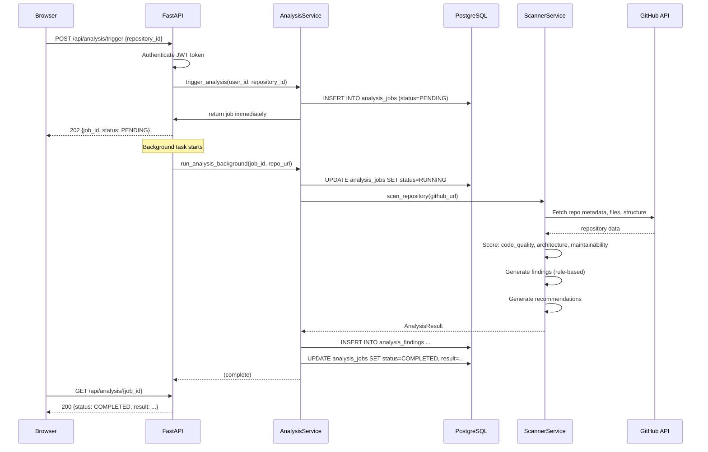
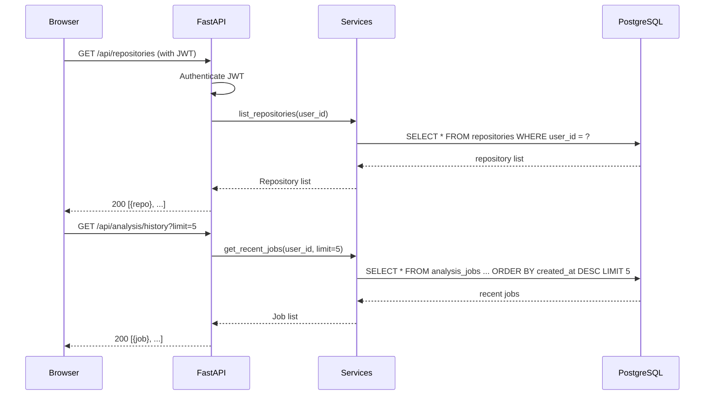
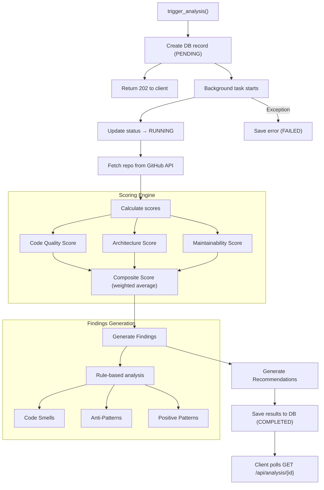

# RepoInsight AI — Architecture Document

## Overview

RepoInsight AI is an AI-powered GitHub repository analysis platform. Users authenticate via JWT, register GitHub repositories, and trigger automated analysis jobs that evaluate code quality, architecture, and maintainability. The system is built on an async Python backend (FastAPI + SQLAlchemy) and a React TypeScript SPA frontend.

---

## Table of Contents

1. [System Overview](#system-overview)
2. [Architecture Layers](#architecture-layers)
3. [Component Diagram](#component-diagram)
4. [Data Flow](#data-flow)
5. [Authentication Architecture](#authentication-architecture)
6. [Analysis Engine Architecture](#analysis-engine-architecture)
7. [Error Handling Strategy](#error-handling-strategy)
8. [Middleware Stack](#middleware-stack)
9. [Database Design Decisions](#database-design-decisions)
10. [Frontend Architecture](#frontend-architecture)
11. [Design System](#design-system)
12. [Security Design](#security-design)
13. [Performance Considerations](#performance-considerations)

---

## System Overview

The platform follows a layered architecture separating client, API gateway, application services, data access, and external integrations.



---

## Architecture Layers

### 1. Client Layer

The frontend is a single-page application built with React 19 and TypeScript 6, bundled with Vite 8.

| Aspect | Implementation |
|--------|----------------|
| Framework | React 19 with hooks |
| Language | TypeScript 6 (strict mode) |
| Bundler | Vite 8 (dev server on port 3000) |
| Styling | CSS Modules with CSS custom properties |
| Routing | React Router v7 |
| State | React Context + hooks (no Redux) |
| HTTP Client | Fetch API with custom wrapper |

**Routing structure**:

```
/                    → Dashboard (protected)
/login               → Login page
/register            → Register page
/repos               → Repository list (protected)
/repos/:id           → Repository detail (protected)
/repos/:id/analysis  → Analysis results (protected)
/health              → Health check (public)
```

**Production build**: Vite produces static files in `dist/` served by Nginx or any static file server. No Node.js runtime is required in production.

### 2. API Gateway (FastAPI)

FastAPI serves as the single entry point for all backend operations. It handles request validation, authentication, routing, and response formatting.

**Key characteristics**:
- ASGI application running on uvicorn
- Async throughout — no synchronous blocking calls
- Automatic OpenAPI/Swagger docs at `/docs` and `/redoc`
- Pydantic models for request/response validation
- Lifespan-managed startup/shutdown (database engine initialization, cleanup)

**Router organization**:

| Router | Prefix | Purpose |
|--------|--------|---------|
| `auth_router` | `/api/auth` | Registration, login, token refresh, user info |
| `repository_router` | `/api/repositories` | CRUD operations on repositories |
| `analysis_router` | `/api/analysis` | Trigger and query analysis jobs |
| `health_router` | `/health` | System health check |

### 3. Application Layer (Services)

Services encapsulate business logic and are injected into route handlers.

| Service | Responsibility |
|---------|----------------|
| `AuthService` | User registration, password hashing (bcrypt), JWT creation/validation, token verification |
| `RepositorySyncService` | GitHub API integration — fetches repo metadata, languages, recent commits; stores/updates repository records |
| `AnalysisJobService` | Creates analysis job records, orchestrates background execution, tracks job status lifecycle |
| `RepositoryScanService` | The actual analysis engine — scores repositories, generates findings and recommendations |

### 4. Data Layer (Repository Pattern)

```
Route Handler → Service → Repository → SQLAlchemy Async → PostgreSQL
```

**Repository pattern** provides:
- Abstracted data access — services never write raw SQL
- Unit-of-work pattern via `AsyncSession`
- Testable data layer — repositories can be mocked in tests
- Consistent query patterns across the application

**Session management**: Each request gets a scoped `AsyncSession` via FastAPI dependency injection. Sessions use the `NullPool` in production to avoid stale connections, and the default async pool in development.

### 5. External Services

| Service | Protocol | Purpose |
|---------|----------|---------|
| GitHub REST API v3 | HTTPS | Fetch repository metadata, languages, recent commits, file trees |
| GitHub OAuth | HTTPS (OAuth2) | Optional — user authentication via GitHub (if configured) |

---

## Component Diagram



---

## Data Flow

### User Registration



### Repository Registration (Sync with GitHub)



### Analysis Triggering (Background Task)



### Dashboard Loading



---

## Authentication Architecture

### JWT Token Flow

```
Client                         Server
  |                               |
  |-- POST /api/auth/login ------>|
  |   {email, password}           |
  |                               |  bcrypt.checkpw(password, hashed)
  |                               |  jwt.encode({sub: user_id, exp: now+30min})
  |<-- 200 {access_token} --------|
  |                               |
  |-- GET /api/repositories ----->|
  |   Authorization: Bearer xxx   |
  |                               |  jwt.decode(token)
  |                               |  verify expiration
  |                               |  extract user_id
  |<-- 200 [...] -----------------|
```

### Token Lifecycle

| Phase | Action |
|-------|--------|
| **Creation** | On successful login: `jwt.encode({sub: user_id, exp: now + 30 minutes}, SECRET_KEY, algorithm=HS256)` |
| **Validation** | On each protected request: decode token, check expiration, extract user_id |
| **Password Storage** | `bcrypt.hashpw(password, bcrypt.gensalt())` — never stored in plaintext |
| **Password Verification** | `bcrypt.checkpw(input_password, stored_hash)` |

### Key Design Decisions

- **No refresh tokens**: Access tokens expire in 30 minutes. Simple and sufficient for this application's threat model.
- **HS256 algorithm**: Shared secret signing. No need for asymmetric keys since a single backend validates tokens.
- **Bearer-only**: The JWT is the sole authentication mechanism. No session cookies.
- **Subject claim**: `sub` contains the user ID (integer). Email is stored separately.
- **User info in token**: Minimal claims — only `sub` (user ID) and `exp` (expiration). No role-based access control.

---

## Analysis Engine Architecture

The analysis engine runs as a FastAPI `BackgroundTasks` job, executing after the HTTP response is returned to the client.

### Job Lifecycle

```
PENDING → RUNNING → COMPLETED
                   → FAILED
```

| Status | Meaning |
|--------|---------|
| `PENDING` | Job created, waiting for background worker |
| `RUNNING` | Analysis is actively executing |
| `COMPLETED` | Analysis finished successfully with results |
| `FAILED` | Analysis encountered an unrecoverable error |

### Execution Pipeline



### Scoring Engine

Three core dimensions are evaluated:

| Dimension | Weight | Evaluates |
|-----------|--------|-----------|
| **Code Quality** | ~33% | File size distribution, function complexity, comment density, naming conventions |
| **Architecture** | ~33% | Directory depth, file organization, module dependency patterns, separation of concerns |
| **Maintainability** | ~33% | Documentation presence, test coverage indicators, dependency count, language diversity |

Each dimension produces a score from 0.0 to 100.0. The composite score is a weighted average.

### Findings

Findings are generated by a rule-based scanner that inspects:

- **Language distribution** — monolithic single-language repos vs. well-distributed
- **File size anomalies** — overly large files that should be split
- **Directory structure** — excessive nesting, flat structures lacking organization
- **Dependency patterns** — too many dependencies, outdated patterns
- **Documentation** — README presence, docstring density, inline comments

Each finding has a `severity` (info, warning, critical) and a `category` (e.g., `code_quality`, `architecture`, `documentation`).

### Recommendations

Generated from findings using templates. Recommendations are prioritized by the severity and impact of the findings that triggered them.

---

## Error Handling Strategy

### AppException Hierarchy

```
AppException (base)
├── NotFoundException       → 404
├── AuthenticationError     → 401
├── AuthorizationError      → 403
├── ValidationException     → 422
├── ConflictException       → 409
└── ExternalServiceException → 502
```

### Middleware Error Handlers

FastAPI middleware catches unhandled exceptions and translates them into consistent responses:

```json
{
  "success": false,
  "error": {
    "code": "NOT_FOUND",
    "message": "Repository not found",
    "details": null
  },
  "meta": {
    "request_id": "abc-123",
    "timestamp": "2026-07-28T12:00:00Z"
  }
}
```

### Error Response Contract

All error responses follow this structure:

| Field | Type | Description |
|-------|------|-------------|
| `success` | `boolean` | Always `false` for errors |
| `error.code` | `string` | Machine-readable error code |
| `error.message` | `string` | Human-readable error description |
| `error.details` | `object \| null` | Additional context (validation errors, etc.) |
| `meta.request_id` | `string` | Unique request identifier for tracing |
| `meta.timestamp` | `string` | ISO 8601 timestamp |

---

## Middleware Stack

Applied in order (first listed runs first on request, last on response):

| Order | Middleware | Purpose |
|-------|-----------|---------|
| 1 | **Request ID** | Generates a unique `X-Request-ID` header for every request. Propagated to logs and responses for distributed tracing. |
| 2 | **Security Headers** | Adds `X-Content-Type-Options`, `X-Frame-Options`, `X-XSS-Protection`, `Referrer-Policy`, `Content-Security-Policy`, `Strict-Transport-Security`. |
| 3 | **CORS** | Configurable allowed origins. Uses `allow_origins` from settings. In production, restricts to the deployed frontend domain. |
| 4 | **Request Logging** | Logs method, path, status code, duration, and client IP. Structured JSON in production. |
| 5 | **Error Handler** | Catches all unhandled exceptions. Translates `AppException` subclasses into appropriate HTTP responses. Returns consistent error format. |
| 6 | **Trusted Host** | Validates `Host` header in production to prevent host header injection attacks. |

---

## Database Design Decisions

### Why Async (asyncpg)

The entire database layer is asynchronous. PostgreSQL access goes through SQLAlchemy 2.0's async engine with the `asyncpg` driver.

**Rationale**: FastAPI is an ASGI framework running on uvicorn. Synchronous database calls would block the event loop, defeating the purpose of async. Every database operation uses `await`, allowing uvicorn to handle other requests while waiting for database I/O.

### Why NullPool in Production

`NullPool` disables SQLAlchemy's connection pooling and creates fresh connections for each request. This is preferred in containerized/serverless environments where:

- Each worker process gets its own connection
- Long-lived pools can hold stale connections
- Orchestrators (Docker, Railway, Render) handle connection management

### Why JSON Columns

Several models use PostgreSQL `JSON` (mapped as `JSONB`) columns for semi-structured data:

| Table | Column | Purpose |
|-------|--------|---------|
| `repositories` | `metadata` | GitHub API response (stars, forks, description, topics) |
| `analysis_jobs` | `result` | Complete analysis result (scores, recommendations) |
| `analysis_findings` | `details` | Finding-specific data (file paths, line numbers, context) |

**Rationale**: GitHub API responses are schema-less and evolve over time. Storing them as JSON avoids rigid schema migrations for every API change. The analysis result is a composite object with nested scores and recommendations — a JSON column avoids a complex relational model for data that is always read/written as a unit.

### Why SQLAlchemy 2.0

SQLAlchemy 2.0 provides:

- Native async support via `AsyncSession`
- Improved type hints and `Mapped` column definitions
- Declarative mapping with `mapped_column()`
- Better integration with modern Python (3.12+ type annotations)

---

## Frontend Architecture

### Component Hierarchy

```
App
├── AuthProvider (Context)
│   ├── PublicLayout
│   │   ├── LoginPage
│   │   └── RegisterPage
│   └── ProtectedLayout
│       ├── Sidebar (navigation)
│       ├── Header (user info, logout)
│       ├── DashboardPage
│       │   ├── StatsCards
│       │   └── RecentAnalysisList
│       ├── RepositoryListPage
│       │   ├── RepositoryCard (x N)
│       │   └── AddRepositoryModal
│       ├── RepositoryDetailPage
│       │   ├── RepositoryInfo
│       │   └── AnalysisHistory
│       └── AnalysisDetailPage
│           ├── ScoreCards
│           ├── FindingsList
│           └── RecommendationsList
```

### State Management

No external state library (Redux, Zustand). State is managed through:

| Pattern | Usage |
|---------|-------|
| **React Context** | `AuthContext` — user session, token, login/logout functions |
| **Component state** | `useState` for local UI state (form inputs, modals, loading flags) |
| **Fetch-on-render** | Data fetched in `useEffect` hooks, stored in component state |

### API Client

Custom `apiClient` wrapper around the Fetch API:

```typescript
// Features:
// - Auto-prepends base URL
// - Attaches Authorization header from AuthContext
// - Parses JSON responses
// - Throws on non-2xx responses
// - Includes request ID for tracing
```

### Routing

React Router v7 with protected route wrappers:

```typescript
// ProtectedRoute checks for valid JWT in AuthContext
// Redirects to /login if no token
// PublicRoute redirects to / if already authenticated
```

---

## Design System

### Theme

Dark theme by default with CSS custom properties.

### Color Palette

| Variable | Value | Usage |
|----------|-------|-------|
| `--bg-primary` | `#0a0a0f` | Main background |
| `--bg-secondary` | `#12121a` | Card/panel background |
| `--bg-tertiary` | `#1a1a25` | Hover/active states |
| `--text-primary` | `#e4e4e7` | Primary text |
| `--text-secondary` | `#a1a1aa` | Secondary/muted text |
| `--accent` | `#6366f1` | Primary action color (indigo) |
| `--accent-hover` | `#818cf8` | Hover state for accent |
| `--success` | `#22c55e` | Success states |
| `--warning` | `#f59e0b` | Warning states |
| `--error` | `#ef4444` | Error states |
| `--border` | `#27272a` | Borders and dividers |

### Typography

- **Font stack**: `Inter, system-ui, -apple-system, sans-serif`
- **Headings**: 600-700 weight, scaled via rem units
- **Body**: 400 weight, 14-16px base size
- **Code**: `JetBrains Mono, Fira Code, monospace`

### CSS Modules

Every component has a co-located `.module.css` file. Class names are locally scoped, preventing style collisions.

---

## Security Design

### CORS Configuration

```python
# Allowed origins are configurable via REPOINSIGHT_CORS_ORIGINS
# In production: only the deployed frontend domain
# In development: localhost:3000
```

### JWT Security

- HS256 signing with a strong secret key (minimum 32 bytes)
- Tokens expire after 30 minutes
- Secret key is never committed to version control
- Tokens transmitted via `Authorization: Bearer` header (not cookies)

### Password Hashing

- **Algorithm**: bcrypt with automatic salting
- **Cost factor**: Default bcrypt work factor (10 rounds)
- **Storage**: Only the hash is stored. Plaintext is never persisted.
- **Verification**: Constant-time comparison via `bcrypt.checkpw()`

### Input Validation

All request bodies are validated through Pydantic models:

- **Type coercion** — automatic conversion where safe
- **Required fields** — enforced at schema level
- **String constraints** — min/max length, regex patterns
- **Email validation** — Pydantic's `EmailStr`
- **Custom validators** — `@field_validator` for domain-specific rules

### Security Headers

Applied via middleware:

```
X-Content-Type-Options: nosniff
X-Frame-Options: SAMEORIGIN
X-XSS-Protection: 1; mode=block
Referrer-Policy: strict-origin-when-cross-origin
Content-Security-Policy: default-src 'self'; ...
Strict-Transport-Security: max-age=31536000; includeSubDomains
```

### Rate Limiting Considerations

Rate limiting is not implemented in-application but is handled at the infrastructure level:

- **Nginx**: `limit_req_zone` and `limit_conn_zone` directives
- **Cloud platforms**: Railway, Render provide built-in rate limiting
- **Application-level**: Future enhancement using `slowapi` (Starlette rate limiter)

---

## Performance Considerations

### Async Throughout

Every I/O operation is asynchronous:

- Database queries (`await session.execute(...)`)
- HTTP calls to GitHub API (`httpx.AsyncClient`)
- Background tasks (FastAPI `BackgroundTasks`)
- File operations (where applicable)

No synchronous blocking calls exist in request handlers.

### N+1 Query Prevention

The repository pattern and service layer use:

- **Eager loading** — `selectinload()` and `joinedload()` for related data
- **Bulk queries** — `select(...).where(...)` with IN clauses instead of per-row lookups
- **Count queries** — Separate `SELECT count(*)` instead of loading all rows

### Connection Pooling

| Environment | Pool Strategy | Configuration |
|-------------|--------------|---------------|
| Development | SQLAlchemy `AsyncAdaptedQueuePool` | Default pool size (5) |
| Production | `NullPool` | Fresh connection per request |

For production with high traffic, switch to a sized pool:

```python
# Alternative for high-traffic production
engine = create_async_engine(
    database_url,
    pool_size=20,
    max_overflow=10,
    pool_timeout=30,
    pool_recycle=3600,
)
```

### Query Optimization

- **Selective columns** — `select(Model.col1, Model.col2)` instead of `select(Model)` when not all columns are needed
- **Pagination** — All list endpoints support `offset` and `limit` parameters
- **Indexed columns** — Foreign keys and frequently queried fields are indexed
- **JSONB operators** — PostgreSQL GIN indexes on JSON columns used in WHERE clauses

### Background Task Strategy

Long-running operations are offloaded to background tasks:

| Operation | Duration | Strategy |
|-----------|----------|----------|
| Repository sync | 2-5 seconds | Background task |
| Full analysis | 10-60 seconds | Background task |
| User registration | <1 second | Synchronous |
| Login | <1 second | Synchronous |

This keeps HTTP response times low while allowing expensive operations to complete.
