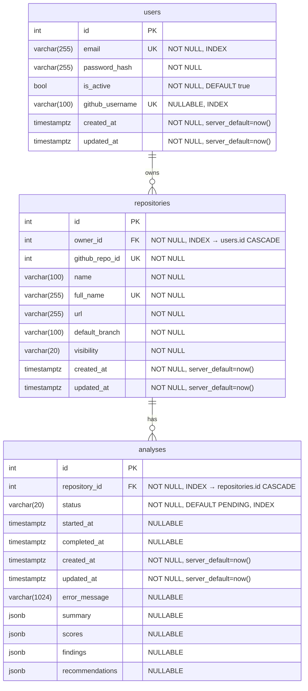
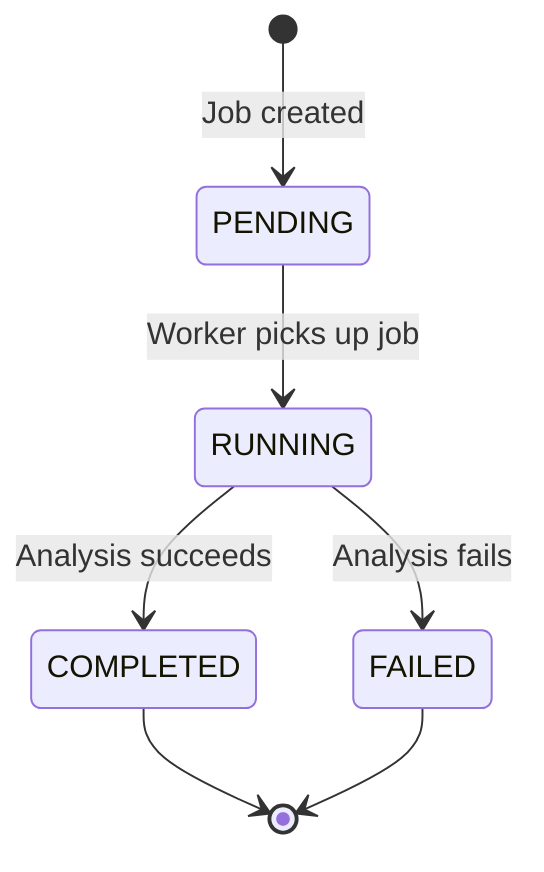

# RepoInsight AI — Database Documentation

> Comprehensive reference for the PostgreSQL database schema, relationships, migrations, and design decisions.

---

## Table of Contents

1. [Overview](#overview)
2. [Entity-Relationship Diagram](#entity-relationship-diagram)
3. [Tables Reference](#tables-reference)
   - [users](#users)
   - [repositories](#repositories)
   - [analyses](#analyses)
4. [Relationships](#relationships)
5. [AnalysisStatus Enum](#analysisstatus-enum)
6. [JSON Columns](#json-columns)
7. [Migration Strategy](#migration-strategy)
8. [Database Design Decisions](#database-design-decisions)

---

## Overview

RepoInsight AI uses **PostgreSQL** as its primary datastore, accessed through **SQLAlchemy 2.0** with the **asyncpg** async driver. The schema consists of three core tables — `users`, `repositories`, and `analyses` — forming a linear ownership chain: a user owns repositories, and each repository has analysis jobs.

Migrations are managed with **Alembic**, ensuring reproducible and version-controlled schema changes.

---

## Entity-Relationship Diagram



---

## Tables Reference

### users

Stores user accounts, credentials, and optional GitHub profile information.

#### Columns

| Column | Type | Constraints | Description |
|--------|------|-------------|-------------|
| `id` | `Integer` | `PRIMARY KEY`, auto-increment | Unique user identifier |
| `email` | `String(255)` | `NOT NULL`, `UNIQUE`, `INDEX` | User's email address, used for login |
| `password_hash` | `String(255)` | `NOT NULL` | Bcrypt-hashed password |
| `is_active` | `Boolean` | `NOT NULL`, `DEFAULT true` | Whether the account is active |
| `github_username` | `String(100)` | `NULLABLE`, `UNIQUE`, `INDEX` | GitHub username, set during OAuth linking |
| `created_at` | `DateTime(tz)` | `NOT NULL`, `server_default=now()` | Account creation timestamp (UTC) |
| `updated_at` | `DateTime(tz)` | `NOT NULL`, `server_default=now()`, `onupdate=now()` | Last update timestamp (UTC) |

#### Relationships

| Relationship | Target Table | Type | Description |
|-------------|-------------|------|-------------|
| `repositories` | `repositories` | One-to-Many | All repositories owned by this user |

#### Indexes

| Index Name | Column(s) | Type |
|------------|-----------|------|
| `ix_users_id` | `id` | Primary Key |
| `ix_users_email` | `email` | Unique |
| `ix_users_github_username` | `github_username` | Unique (partial — NULLs allowed) |

---

### repositories

Stores GitHub repository metadata synced from the GitHub API.

#### Columns

| Column | Type | Constraints | Description |
|--------|------|-------------|-------------|
| `id` | `Integer` | `PRIMARY KEY`, auto-increment | Internal repository identifier |
| `owner_id` | `Integer` | `NOT NULL`, `FOREIGN KEY → users.id`, `ON DELETE CASCADE`, `INDEX` | Owner's user ID |
| `github_repo_id` | `Integer` | `NOT NULL`, `UNIQUE`, `INDEX` | GitHub's repository ID (from API) |
| `name` | `String(100)` | `NOT NULL` | Repository name (e.g., `my-project`) |
| `full_name` | `String(255)` | `NOT NULL`, `UNIQUE`, `INDEX` | Full name with owner (e.g., `user/my-project`) |
| `url` | `String(255)` | `NOT NULL` | Repository URL on GitHub |
| `default_branch` | `String(100)` | `NOT NULL` | Default branch name (e.g., `main`) |
| `visibility` | `String(20)` | `NOT NULL` | Visibility: `public` or `private` |
| `created_at` | `DateTime(tz)` | `NOT NULL`, `server_default=now()` | Record creation timestamp (UTC) |
| `updated_at` | `DateTime(tz)` | `NOT NULL`, `server_default=now()`, `onupdate=now()` | Last sync/update timestamp (UTC) |

#### Relationships

| Relationship | Target Table | Type | Description |
|-------------|-------------|------|-------------|
| `owner` | `users` | Many-to-One | The user who owns this repository |
| `analyses` | `analyses` | One-to-Many | All analysis jobs for this repository |

#### Indexes

| Index Name | Column(s) | Type |
|------------|-----------|------|
| `ix_repositories_id` | `id` | Primary Key |
| `ix_repositories_owner_id` | `owner_id` | Foreign Key |
| `ix_repositories_github_repo_id` | `github_repo_id` | Unique |
| `ix_repositories_full_name` | `full_name` | Unique |

---

### analyses

Stores analysis job records with status tracking and JSON result payloads.

#### Columns

| Column | Type | Constraints | Description |
|--------|------|-------------|-------------|
| `id` | `Integer` | `PRIMARY KEY`, auto-increment | Analysis job identifier |
| `repository_id` | `Integer` | `NOT NULL`, `FOREIGN KEY → repositories.id`, `ON DELETE CASCADE`, `INDEX` | Parent repository ID |
| `status` | `String(20)` (Enum) | `NOT NULL`, `DEFAULT 'PENDING'`, `INDEX` | Job status (see [AnalysisStatus Enum](#analysisstatus-enum)) |
| `started_at` | `DateTime(tz)` | `NULLABLE` | When analysis execution began (UTC) |
| `completed_at` | `DateTime(tz)` | `NULLABLE` | When analysis finished (UTC) |
| `created_at` | `DateTime(tz)` | `NOT NULL`, `server_default=now()` | Record creation timestamp (UTC) |
| `updated_at` | `DateTime(tz)` | `NOT NULL`, `server_default=now()`, `onupdate=now()` | Last status update timestamp (UTC) |
| `error_message` | `String(1024)` | `NULLABLE` | Error details if status is `FAILED` |
| `summary` | `JSON` | `NULLABLE` | High-level analysis summary (see [JSON Columns](#json-columns)) |
| `scores` | `JSON` | `NULLABLE` | Numeric scores per category (see [JSON Columns](#json-columns)) |
| `findings` | `JSON` | `NULLABLE` | Array of code findings (see [JSON Columns](#json-columns)) |
| `recommendations` | `JSON` | `NULLABLE` | Array of improvement strings (see [JSON Columns](#json-columns)) |

#### Relationships

| Relationship | Target Table | Type | Description |
|-------------|-------------|------|-------------|
| `repository` | `repositories` | Many-to-One | The repository this analysis belongs to |

#### Indexes

| Index Name | Column(s) | Type |
|------------|-----------|------|
| `ix_analyses_id` | `id` | Primary Key |
| `ix_analyses_repository_id` | `repository_id` | Foreign Key |
| `ix_analyses_status` | `status` | Standard (filter by status) |

---

## Relationships

### Ownership Chain

```text
User (1) ──owns──> (N) Repository (1) ──has──> (N) Analysis
```

- A **user** owns many **repositories**. Each repository belongs to exactly one user.
- A **repository** has many **analyses**. Each analysis belongs to exactly one repository.

### Cascade Rules

| Relationship | Cascade | Behavior |
|-------------|---------|----------|
| `repositories.owner_id → users.id` | `ON DELETE CASCADE` | Deleting a user deletes all their repositories |
| `analyses.repository_id → repositories.id` | `ON DELETE CASCADE` | Deleting a repository deletes all its analyses |

**Rationale:** Cascade delete ensures no orphaned records. When a user is removed, all their connected data (repositories and analyses) is cleaned up automatically. This is safe because the application enforces ownership checks before any mutation.

---

## AnalysisStatus Enum

The `status` column on `analyses` uses a string-backed enum with four states:

| Value | Description |
|-------|-------------|
| `PENDING` | Job created but not yet started. Initial state for all new analyses. |
| `RUNNING` | Job is actively being processed by the analysis engine. |
| `COMPLETED` | Job finished successfully. `summary`, `scores`, `findings`, and `recommendations` are populated. |
| `FAILED` | Job encountered an error. `error_message` contains failure details. `summary`/`scores`/`findings` are `NULL`. |

**State machine:**



---

## JSON Columns

All JSON columns are stored as `JSON` (JSONB) in PostgreSQL, allowing flexible schema evolution without migrations.

### `summary`

High-level analysis overview. Structure varies by analysis engine version.

```json
{
    "total_files_scanned": 142,
    "total_lines_of_code": 12480,
    "language_breakdown": {
        "Python": 8200,
        "TypeScript": 4280
    },
    "analysis_duration_seconds": 34.7
}
```

### `scores`

Numeric scores (0–100) for each evaluation category. Used for dashboard visualizations and trend tracking.

```json
{
    "code_quality": 85,
    "architecture": 72,
    "maintainability": 80,
    "security": 91,
    "documentation": 65
}
```

**Scoring scale:** 0–100 where higher is better. Scores are computed by the analysis engine and stored as integers.

### `findings`

Array of individual code issues discovered during analysis. Each finding has a consistent schema:

```json
[
    {
        "rule_id": "CQ-001",
        "severity": "warning",
        "category": "code_quality",
        "title": "Function exceeds 50 lines",
        "description": "Function `process_batch` in `src/worker.py` is 87 lines long.",
        "file_path": "src/worker.py",
        "line_number": 42,
        "recommendation": "Extract helper functions to reduce function length."
    },
    {
        "rule_id": "SEC-003",
        "severity": "critical",
        "category": "security",
        "title": "Hardcoded secret detected",
        "description": "Potential API key found in configuration file.",
        "file_path": "config/settings.py",
        "line_number": 15,
        "recommendation": "Move secrets to environment variables."
    }
]
```

| Field | Type | Description |
|-------|------|-------------|
| `rule_id` | `string` | Unique identifier for the analysis rule (e.g., `CQ-001`, `SEC-003`) |
| `severity` | `string` | `info`, `warning`, `error`, or `critical` |
| `category` | `string` | Classification: `code_quality`, `security`, `architecture`, `maintainability`, `documentation` |
| `title` | `string` | Short human-readable title |
| `description` | `string` | Detailed explanation of the issue |
| `file_path` | `string` | Relative path to the affected file |
| `line_number` | `int \| null` | Line number where the issue was found (if applicable) |
| `recommendation` | `string` | Suggested fix or improvement |

### `recommendations`

Flat array of improvement suggestions, independent of specific findings:

```json
[
    "Consider adding type hints to all public functions in the API layer",
    "The test coverage for `app/services/` is below 60% — add integration tests",
    "Migrate from `datetime.utcnow()` to timezone-aware `datetime.now(timezone.utc)`",
    "Split the monolithic `worker.py` into focused modules"
]
```

---

## Migration Strategy

### Alembic Setup

Migrations live in `backend/alembic/versions/` and are managed by Alembic with async support (`asyncpg`). The Alembic config reads the database URL from `app.core.config.Settings`.

### Migration Files

| # | File | Description |
|---|------|-------------|
| 1 | `20260717_init_database_foundation.py` | Creates initial `users` table with core auth fields |
| 2 | `20260718_create_domain_models.py` | Creates `repositories` and `analyses` tables, establishes foreign keys |
| 3 | `20260723_add_analysis_result_fields.py` | Adds `summary`, `scores`, `findings`, `recommendations` JSON columns to `analyses` |
| 4 | `20260724_add_updated_at_to_analysis.py` | Adds `updated_at` column to `analyses` |
| 5 | `20260727_add_auth_fields_to_user.py` | Adds `github_username`, `is_active`, and auth-related fields to `users` |

### Creating New Migrations

```bash
# Auto-generate migration from model changes
alembic revision --autogenerate -m "<description>"

# Create empty migration for manual SQL
alembic revision -m "<description>"
```

### Naming Convention

Migration filenames follow the pattern:

```
YYYYMMDD_<snake_case_description>.py
```

Examples:
- `20260728_add_index_to_analytics.py`
- `20260730_create_webhook_events_table.py`

The description should be concise, use underscores (not hyphens), and describe the schema change.

### Applying Migrations

```bash
# Apply all pending migrations
alembic upgrade head

# Rollback one migration
alembic downgrade -1

# Rollback to a specific revision
alembic downgrade <revision_id>

# View current migration version
alembic current

# View migration history
alembic history
```

### Rollback Procedure

1. Identify the migration to rollback: `alembic history`
2. Test the rollback in a staging environment first: `alembic downgrade -1`
3. Verify application behavior after rollback
4. If the rollback involves data loss, ensure a backup exists before executing

---

## Database Design Decisions

### Why JSON for Flexible Fields?

The `analyses` table uses `JSON` (JSONB) columns for `summary`, `scores`, `findings`, and `recommendations` rather than normalized tables.

**Reasons:**
- **Schema flexibility:** Analysis output structure evolves as new rules and engines are added. JSON avoids a migration for every new finding type or score category.
- **Read efficiency:** The entire analysis result is loaded as a single row. There are no JOINs needed to reconstruct the result set.
- **Write efficiency:** Results are written atomically in one INSERT/UPDATE. No need to coordinate inserts across multiple tables.
- **Trade-off:** Querying inside JSON (e.g., "find all analyses with `code_quality > 80`") requires JSON path queries, which are slower than indexed columns. This is acceptable because analysis results are read as whole documents, not filtered by individual score values.

### Why Enum as String?

The `status` column stores enum values as strings (`'PENDING'`, `'RUNNING'`, etc.) rather than using PostgreSQL's native `ENUM` type.

**Reasons:**
- **Migration simplicity:** Adding a new status value requires no `ALTER TYPE` DDL or migration. Just update the Python enum and the application layer.
- **Portability:** String values are database-agnostic and work identically across PostgreSQL, SQLite (testing), and any future database.
- **Readability:** Raw SQL queries and logs show human-readable strings instead of integer codes.

### Cascade Delete Strategy

Both foreign keys use `ON DELETE CASCADE`:

```text
users.id ←──CASCADE── repositories.owner_id
repositories.id ←──CASCADE── analyses.repository_id
```

**Rationale:**
- **Data integrity:** No orphaned records are possible. The ownership chain is enforced at the database level.
- **Application simplicity:** Services don't need to manually delete child records before deleting a parent.
- **Safety:** The application always verifies ownership before any delete operation. Cascade only fires after explicit user intent.

**Alternative considered:** `ON DELETE RESTRICT` was rejected because it would require the application to delete analyses before repositories and repositories before users, adding complexity with no practical benefit — users who delete their account expect all associated data to be removed.
