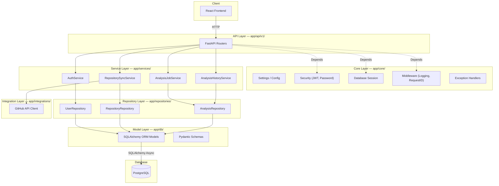
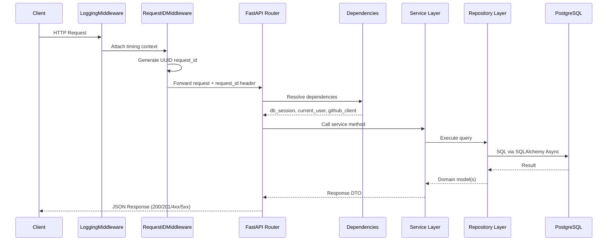
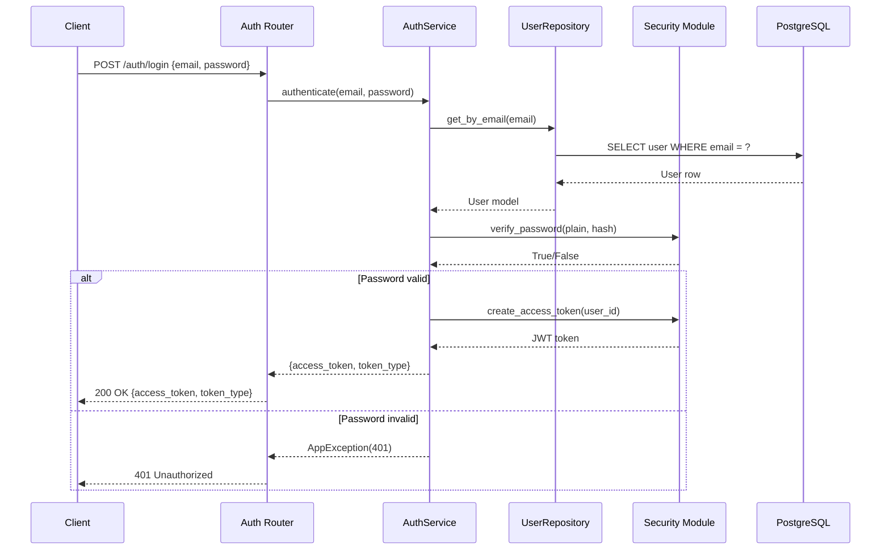
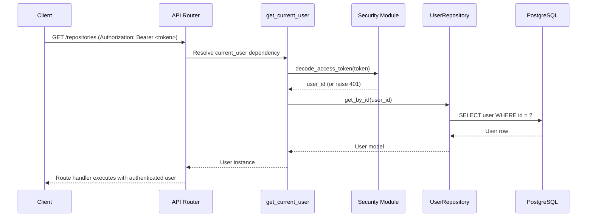
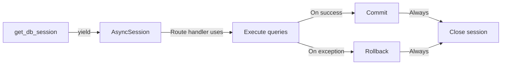

# RepoInsight AI — Developer Guide

> Comprehensive guide for developers contributing to the RepoInsight AI platform.

---

## Table of Contents

1. [Project Overview](#project-overview)
2. [Project Architecture](#project-architecture)
3. [Request Flow](#request-flow)
4. [Authentication Flow](#authentication-flow)
5. [Database Flow](#database-flow)
6. [Dependency Injection](#dependency-injection)
7. [Error Handling](#error-handling)
8. [Logging](#logging)
9. [Configuration](#configuration)
10. [Coding Conventions](#coding-conventions)
11. [Git Branch Strategy](#git-branch-strategy)
12. [Commit Convention](#commit-convention)

---

## Project Overview

RepoInsight AI is an AI-powered GitHub repository analysis platform. It allows users to authenticate via email/password, connect their GitHub repositories, trigger automated code analysis jobs, and view historical analysis results with scores, findings, and recommendations.

**Tech stack:**

| Layer       | Technology                                                                 |
|-------------|---------------------------------------------------------------------------|
| Backend     | Python 3.12, FastAPI, SQLAlchemy 2.0 (async), Pydantic v2               |
| Database    | PostgreSQL (asyncpg driver), Alembic migrations                         |
| Auth        | passlib/bcrypt (password hashing), python-jose (JWT)                    |
| Frontend    | React 19, TypeScript 6, Vite 8, React Router 7, CSS Modules            |
| Testing     | pytest-asyncio (backend), vitest (frontend)                              |
| Lint        | oxlint (frontend)                                                         |

---

## Project Architecture

The backend follows a **layered architecture** with clear separation of concerns:



### Layer Responsibilities

| Layer | Location | Responsibility |
|-------|----------|----------------|
| **API Layer** | `app/api/v1/` | HTTP request parsing, response building, route definitions. Routers are thin — they delegate to services immediately. |
| **Service Layer** | `app/services/` | Business logic, orchestration of multiple repositories and integrations. Services are stateless and receive dependencies via constructor injection. |
| **Repository Layer** | `app/repositories/` | Data access abstraction. Each entity has a repository class extending `BaseRepository` with typed CRUD operations. |
| **Model Layer** | `app/db/models.py` | SQLAlchemy ORM models defining table structure, relationships, indexes, and constraints. |
| **Integration Layer** | `app/integrations/` | External API clients (e.g., GitHub REST/GraphQL API). Isolated from business logic. |
| **Core Layer** | `app/core/` | Cross-cutting concerns: configuration, security utilities, database session factory, middleware, and centralized exception handling. |

---

## Request Flow

Every incoming HTTP request follows a predictable pipeline:



**Key points:**
- `RequestIDMiddleware` generates a UUID for every request, returned in the response header `X-Request-ID`.
- `LoggingMiddleware` logs request method, path, status code, and elapsed time at `INFO` level.
- FastAPI's dependency injection resolves `db_session`, `current_user`, and `github_client` before the route handler executes.

---

## Authentication Flow

### Login



### Subsequent Requests (Bearer Token)



**Security details:**
- Passwords are hashed with **bcrypt** via `passlib`.
- JWT tokens encode `sub` (user ID) and `exp` (expiration).
- The `get_current_user` dependency extracts the token from the `Authorization: Bearer <token>` header, decodes it, and loads the user from the database.

---

## Database Flow

### Session Management

Database sessions are managed through a FastAPI dependency that yields an async session and ensures proper cleanup:



**Pattern:**
1. `get_db_session` creates an `AsyncSession` from the engine.
2. It **yields** the session to the route handler.
3. If the handler completes successfully, the session **commits** automatically.
4. If an exception occurs, the session **rolls back**.
5. The session is **closed** in a `finally` block regardless of outcome.

**Rules:**
- Never create sessions manually outside the dependency.
- All queries must be `await`ed (async I/O).
- Repositories receive a session via constructor — they do not create their own.
- Long-running transactions should be avoided; keep sessions short-lived.

---

## Dependency Injection

FastAPI's `Depends()` is the backbone of the architecture. All shared resources are injected this way:

| Dependency | Module | Purpose | Scope |
|------------|--------|---------|-------|
| `get_db_session` | `app/core/database.py` | Yields an `AsyncSession` with auto-commit/rollback. | Per-request |
| `get_current_user` | `app/core/security.py` | Decodes JWT, loads user from DB. Raises 401 if invalid/expired. | Per-request |
| `get_github_client` | `app/integrations/github.py` | Returns an authenticated GitHub API client using the user's OAuth token. | Per-request |
| `verify_repository_owner` | `app/api/v1/deps.py` | Loads repository by ID and verifies the authenticated user is the owner. Raises 404 if not found, 403 if not owner. | Per-request |
| `verify_analysis_owner` | `app/api/v1/deps.py` | Loads analysis by ID, verifies the parent repository belongs to the authenticated user. Raises 404/403 accordingly. | Per-request |

**Example usage in a route handler:**

```python
@router.get("/repositories/{repo_id}")
async def get_repository(
    repo: Repository = Depends(verify_repository_owner),
    current_user: User = Depends(get_current_user),
):
    return repo
```

**Key principles:**
- Dependencies can depend on other dependencies (e.g., `verify_repository_owner` depends on `get_db_session` and `get_current_user`).
- Use `yield` dependencies for resources that need cleanup (sessions).
- Use regular `async def` dependencies for pure lookups.

---

## Error Handling

### Exception Hierarchy

```
AppException (base)
├── AuthenticationError     (401)
├── AuthorizationError      (403)
├── NotFoundError           (404)
├── ValidationError         (422)
└── ConflictError           (409)
```

All custom exceptions inherit from `AppException`, which carries:
- `status_code: int` — HTTP status code
- `message: str` — Human-readable error message
- `detail: str | None` — Optional additional context

### Exception Handlers

Registered in `main.py`, these handlers catch `AppException` subclasses and return structured JSON responses:

```json
{
    "error": {
        "code": 404,
        "message": "Repository not found",
        "detail": "No repository with id 42 exists for this user"
    }
}
```

Unhandled exceptions (e.g., unexpected `RuntimeError`) are caught by a generic handler that returns `500 Internal Server Error` without exposing internal details.

### Error Response Format

All error responses follow the same shape:

| Field | Type | Description |
|-------|------|-------------|
| `error.code` | `int` | HTTP status code |
| `error.message` | `string` | Short, human-readable description |
| `error.detail` | `string \| null` | Optional context or validation errors |

---

## Logging

### Configuration

Logging is configured at application startup via Python's `logging` module. The root logger is set to `INFO` level with a structured formatter:

```
%(asctime)s | %(levelname)-8s | %(name)s | %(message)s
```

### Middleware Logging

`LoggingMiddleware` wraps every request and logs:
- **Request**: `INFO` — method, path, client IP
- **Response**: `INFO` — status code, elapsed time in milliseconds

```text
2026-07-28 10:15:32 | INFO     | app.core.middleware | POST /api/v1/auth/login — 200 (142ms)
```

### Log Levels

| Level | Usage |
|-------|-------|
| `DEBUG` | Verbose diagnostic information (disabled in production) |
| `INFO` | Request/response logging, service lifecycle events |
| `WARNING` | Recoverable issues (e.g., GitHub API rate limit approaching) |
| `ERROR` | Unhandled exceptions, failed external API calls |
| `CRITICAL` | Database connection failures, unrecoverable system errors |

---

## Configuration

### Settings Class

All configuration is centralized in `app/core/config.py` via a Pydantic `Settings` class:

```python
class Settings(BaseSettings):
    DATABASE_URL: str
    SECRET_KEY: str
    ACCESS_TOKEN_EXPIRE_MINUTES: int = 30
    GITHUB_CLIENT_ID: str
    GITHUB_CLIENT_SECRET: str
    # ...
```

### Environment Variables

Loaded from `.env` (development) or environment variables (production). Pydantic validates types and applies defaults automatically.

### `lru_cache` Pattern

The `Settings` instance is created once and cached using `functools.lru_cache`:

```python
@lru_cache
def get_settings() -> Settings:
    return Settings()
```

This ensures the `.env` file is parsed only once at startup, not on every request. Access it via `Depends(get_settings)` in route handlers or services.

---

## Coding Conventions

### Backend (Python)

| Aspect | Convention |
|--------|-----------|
| **Formatter** | Black (line length 88) |
| **Import sorting** | isort (Black-compatible profile) |
| **Type hints** | Full type annotations on all function signatures |
| **Docstrings** | Google-style docstrings on public functions and classes |
| **Async** | `async/await` throughout — no blocking I/O calls |
| **Naming** | `snake_case` for functions/variables, `PascalCase` for classes |
| **File structure** | One model per class, one router per domain entity |

### Frontend (React / TypeScript)

| Aspect | Convention |
|--------|-----------|
| **Linting** | oxlint |
| **TypeScript** | Strict mode enabled |
| **Components** | Functional components only, no class components |
| **Styling** | CSS Modules (`*.module.css`) |
| **State** | React hooks (`useState`, `useEffect`, `useContext`) |
| **Routing** | React Router v7 with file-based or explicit route definitions |
| **Naming** | `PascalCase` for components, `camelCase` for functions/variables |

---

## Git Branch Strategy

```text
main ─────────────────────────────────────────────── production
  │
  └── develop ────────────────────────────────────── integration
        │
        ├── feature/analysis-dashboard ───────────── feature work
        ├── feature/github-oauth-flow ────────────── feature work
        ├── fix/null-pointer-on-login ────────────── bug fixes
        └── fix/analysis-timeout-handling ────────── bug fixes
```

| Branch | Purpose | Merges into |
|--------|---------|-------------|
| `main` | Production-ready code, tagged releases | — |
| `develop` | Integration branch for next release | `main` via PR |
| `feature/*` | New features in progress | `develop` via PR |
| `fix/*` | Bug fixes in progress | `develop` via PR |

**Rules:**
- Never push directly to `main`.
- All merges to `develop` require a pull request and passing CI.
- Branch names are lowercase, hyphen-separated, prefixed with `feature/` or `fix/`.

---

## Commit Convention

This project follows [Conventional Commits](https://www.conventionalcommits.org/):

```
<type>(<scope>): <description>
```

### Types

| Type | Usage |
|------|-------|
| `feat` | New feature |
| `fix` | Bug fix |
| `docs` | Documentation only |
| `style` | Formatting, no logic change |
| `refactor` | Code restructuring, no feature/fix |
| `test` | Adding or updating tests |
| `chore` | Build, CI, dependency updates |
| `perf` | Performance improvement |

### Scope

The scope is the affected module or layer:

| Scope | Applies to |
|-------|-----------|
| `api` | API routes and request handling |
| `auth` | Authentication and authorization |
| `repo` | Repository sync and management |
| `analysis` | Analysis jobs and results |
| `db` | Database models and migrations |
| `core` | Config, security, middleware |
| `ui` | Frontend components |
| `ci` | CI/CD pipeline |

### Examples

```text
feat(analysis): add scoring algorithm for code quality
fix(auth): handle expired JWT tokens gracefully
docs(db): add ERD diagram to DATABASE.md
refactor(repo): extract GitHub client into integration layer
test(analysis): add unit tests for AnalysisJobService
chore(ci): configure vitest coverage thresholds
```

**Rules:**
- Subject line is imperative mood, lowercase, no period.
- Body (optional) explains **what** and **why**, not **how**.
- Footer (optional) references issue IDs: `Closes #123`.
